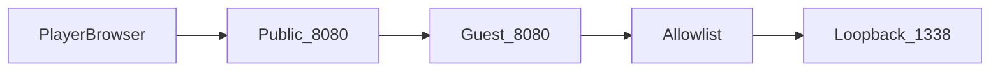
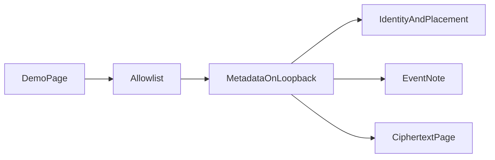
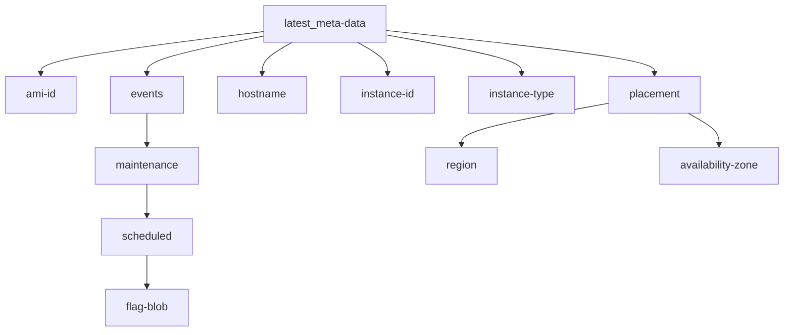

# Architecture

This guide tells you how the AWS-style simulation is put together on a Proxmox host.

The simulation is a local demo of server-side request forgery. Server-side request forgery means the server requests a URL that the visitor chooses. The catalog is AWS-shaped. It holds no cloud credentials. It has no `iam` path.

The source files live in the `imds-demo` directory. The guest notes live in `guest-notes.md`. The build steps live in `implementation-guide.md`.

## How a player reaches it

Players open the public page on port `8080`. That address is the public side of the router. The router sends TCP `8080` to the guest address on port `8080`.

Port `1338` is not part of the public solve. The catalog listens only on `127.0.0.1:1338` inside the guest. A forward of public port `1338` to that same port does not serve the page, and players do not need it.

## Request flow

The page asks the guest to fetch one URL. The guest fetches that URL only when the host is `127.0.0.1`, the port is `1338`, and the scheme is `http`.

The visible page does not name that host or port. A fetch to anywhere else returns a refusal that does. The first metadata path is in an HTML comment in the page source.

Loopback means the address `127.0.0.1`. That address stays inside the guest. A browser on another computer cannot open port `1338`. The URL box can, because the guest makes the request.

## Catalog flow

The first metadata address is an index. A name that ends with `/` is a folder. A name with no slash is a value. The event note names the ciphertext page. Ciphertext means text that still needs a key.

Every metadata body starts with this sentence: "This is a local simulation of an AWS-style metadata service. It holds no cloud credentials."

## Parts

- One Proxmox host. Proxmox is the program that runs the guests.
- One Debian 12 guest, name `imds-demo`, with a static LAN address.
- `imds-demo.service` listens on `0.0.0.0:8080`. This is the page.
- `imds-metadata.service` listens on `127.0.0.1:1338`. This is the catalog.
- `/var/lib/imds-demo/decrypt-key` and `/var/lib/imds-demo/ciphertext` hold the puzzle. The flag file `/root/imds-demo-flag` is not in the repository.
- `/usr/local/sbin/imds-token-only` turns token-only mode on or off. In that mode a plain GET fails. The player path does not mint a token.
- `nftables` on the guest allows ICMP and TCP `22` from the LAN, and TCP `8080` from any source. A router forward keeps the visitor source address, so a LAN-only rule on `8080` drops it.

The datacenter firewall on the host stays off. The guest firewall file repeats an allow list. It does not filter traffic while the datacenter firewall is off.

## Copy the guest

Follow `implementation-guide.md` on the Proxmox host. That guide has the create commands, the firewall rules, and the checks that matched a working install.

Do not enable the datacenter firewall for this copy. If you enable it with no host rules, that firewall can block management of the host and the other guests.

On the router, forward external TCP `8080` to the guest address on port `8080`. Leave public port `1338` unused. The page only fetches `http://127.0.0.1:1338/`, so a visitor cannot use it as an open proxy while that allowlist stays in place.

## Confirm the copy

Run the validate section in `implementation-guide.md` from a computer that is not on the LAN. That section walks the public page, the refusal, the catalog, the decrypt, the closed metadata port, and token-only mode. Leave token-only mode off at the end.
